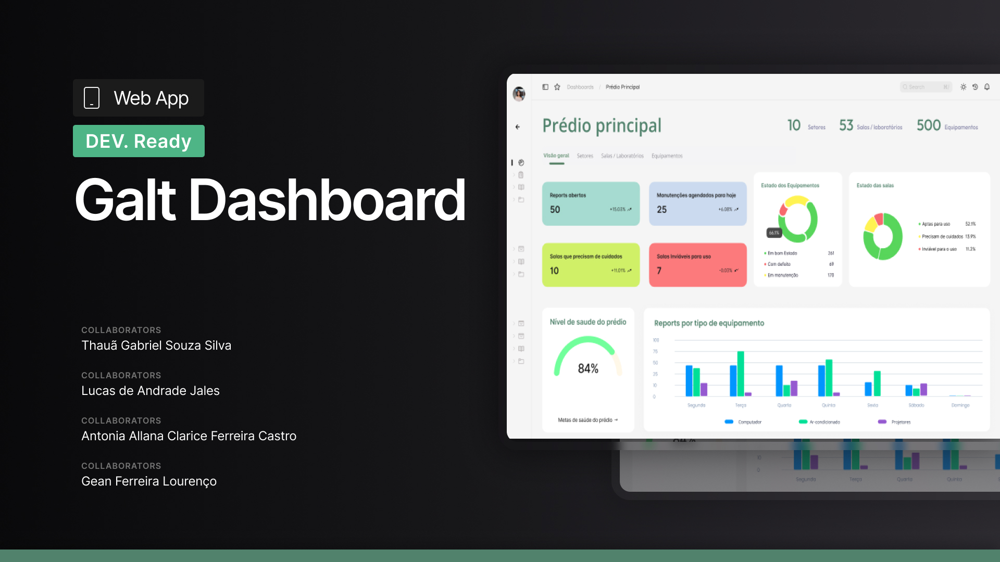

# GALT – Sistema de Gerenciamento de Equipamentos e Salas

## Descrição

O GALT é um sistema web desenvolvido para otimizar a gestão de equipamentos, salas e laboratórios em instituições de ensino. Ele centraliza informações sobre o estado dos recursos, permitindo abertura de chamados, acompanhamento de manutenções e geração de métricas de uso e falhas. A interface é responsiva, garantindo acessibilidade tanto em desktops quanto em dispositivos móveis, e oferece diferentes níveis de acesso para alunos, professores, técnicos de TI e administradores.

##  O que o sistema faz

O GALT permite que alunos e professores registrem problemas com equipamentos de forma prática, abrindo chamados de manutenção rapidamente. Técnicos de TI podem acompanhar esses chamados, atualizar o estado dos equipamentos e agendar períodos de manutenção, tornando seu trabalho mais simples, pois o sistema gerencia automaticamente mudanças de estado de equipamentos conforme o resultado das manutenções. Dessa forma, os técnicos podem focar apenas na execução das tarefas de manutenção, enquanto o sistema garante que o estado de cada recurso esteja sempre atualizado e correto.

O sistema oferece ainda leitura de QR Codes para acesso rápido às informações de cada equipamento, exibição de plantas das salas com cores indicando o estado dos equipamentos, notificações automáticas por email quando problemas são resolvidos e geração de relatórios e métricas detalhadas sobre histórico de falhas e tempo de atendimento. Todas as alterações são registradas em logs auditáveis, garantindo rastreabilidade e transparência em todas as operações. Além disso, o GALT organiza de maneira eficiente a estrutura de gestão de recursos, permitindo associar equipamentos a salas, salas a setores e setores a prédios, criando um mapeamento completo da instituição e centralizando a comunicação e controle de todos os usuários.

